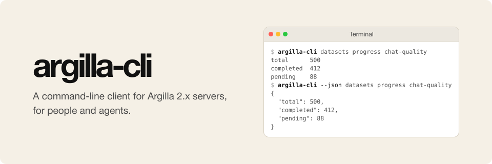

# argilla-cli

<p align="center">
  
</p>

argilla-cli is a command-line client for Argilla 2.x servers, for people and agents.
It logs in, manages workspaces, users, datasets, records, responses, and suggestions, and moves review data in and out of a server as JSON and JSONL.
Every command takes `--json`, so the same command prints a short table for people and JSON for agents.

## Quick look

```console
$ argilla-cli --json workspaces list
[
  {
    "id": "3fa5-...",
    "name": "review",
    ...
  }
]
```

## Install

Requires Python 3.10 or newer. With [uv](https://docs.astral.sh/uv/), install from this repository (the package is not on PyPI):

```bash
uv tool install git+https://github.com/osolmaz/argilla-cli
```

or from a local checkout:

```bash
uv sync --dev
uv run argilla-cli --help
```

The bundled `argilla` SDK is pinned to 2.8.0, matching Argilla 2.8 servers. `doctor` warns when the server version differs.

## Login

Two login methods; an API key always wins over a username and password when both are present.

```bash
# With an API key (no username needed)
argilla-cli login --url https://argilla.example.org --api-key ARGILLA_API_KEY

# With a username and password; the server's API key is kept in memory only
argilla-cli login --url https://argilla.example.org --username amelie
```

`login` saves the account under a kubectl-context-style name (the URL's host, or `host-username` when taken) and makes it active. `whoami` and `doctor` report which method the account uses, without showing the secret.

A credentials file works too, and is read at run time, never copied:

```bash
argilla-cli --credentials-file ~/secrets/argilla.env datasets list
```

The file holds `URL`/`USERNAME`/`PASSWORD` or `API_KEY`, with or without the `ARGILLA_` prefix.

## Accounts

```bash
argilla-cli account list            # saved accounts, * marks the active one
argilla-cli account use other-host  # switch
argilla-cli --account other-host datasets list
argilla-cli account remove other-host
```

## Commands

Every command takes `--json` and exits non-zero on failure; without it, output is a short table.

- `login`, `setup`, `whoami`, `info`, `doctor`
- `workspaces list | create | delete | add-user | remove-user`
- `users list | get | create | delete`
- `datasets list | get | create | update | delete | progress | export | import`
  - `datasets get NAME --settings` dumps the settings document (JSON or YAML) so a format can be reviewed or copied
  - `datasets create "New review" --like "Added criteria review: Kein Review follow-up"` copies an existing dataset's settings
- `records list | get | add | update | delete`
  - `records add DATASET --file records.jsonl` reads flat JSON or JSONL (field names as keys, an optional `id`), and upserts by `id`, so a rerun does not duplicate records
- `responses list | export | submit`
  - `responses submit DATASET RECORD --answers '{"quality": "ok"}'`
  - `responses list DATASET --user amelie` filters by username or status
- `suggestions add DATASET --file suggestions.jsonl`
  - each line: `{"id": "<record id>", "quality": "good"}`

## Configuration

Accounts live in `~/.argilla-cli/config.json` (directory 0700, file 0600). `config show` prints it with secrets masked. The resolution order is flags, then the environment (`ARGILLA_API_URL`, `ARGILLA_API_KEY`, `ARGILLA_USERNAME`, `ARGILLA_PASSWORD`), then the named or active account.

## Safety

- Secrets are never printed: not by `config show`, not in errors, not in tables.
- Destructive commands (`delete`, `remove-user`) ask for confirmation; without a terminal they need `--yes`.
- `create`, `add`, and `import` take `--dry-run`.
- Each account carries a permission profile: `full` (the default) or `read-only`, which refuses every write. Override one invocation with `--profile`.
